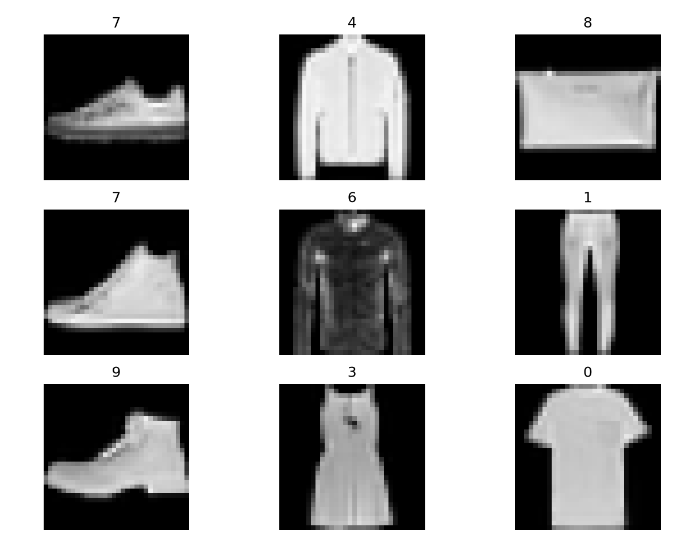
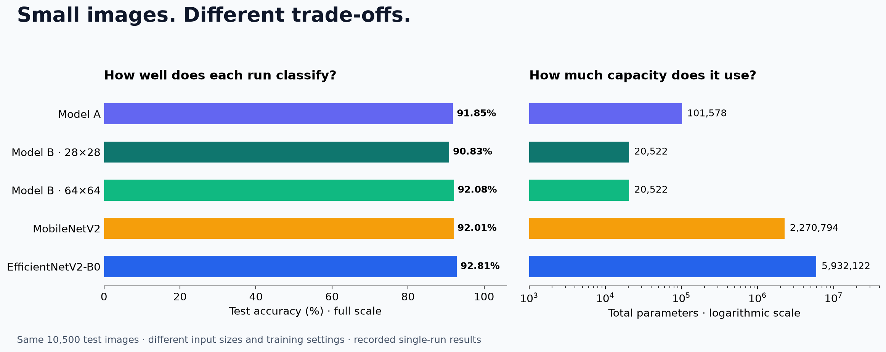
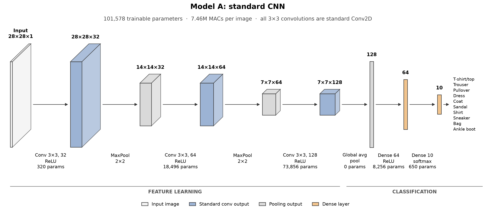
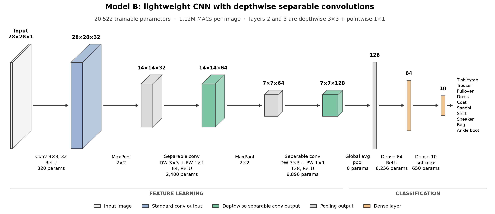
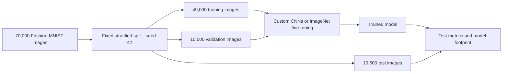

# CNN Image Classification

*Small images. Small models. Real trade-offs.*

**Four CNN architectures, one shared Fashion-MNIST split, and a practical question: how much accuracy can we keep as models get smaller?**

We build two custom networks from scratch, fine-tune **MobileNetV2** and **EfficientNetV2-B0**, and compare classification quality with parameter count and model footprint. This repository contains the training code, experiment notebooks, saved metrics and figures for our **EN3150 image classification project**.

**92.81%** highest recorded test accuracy · **20,522** parameters in our compact custom CNN · **10,500** shared test images

[Results](#results-at-a-glance) · [Models](#meet-the-models) · [Run it](#run-it-yourself) · [Interactive explorer](documents/readme/results_explorer.html) · [Experiments](#explore-the-experiments)

<p align="center">
  
</p>

*Clothing recognition at just 28×28 pixels. The numbers above the samples are dataset class IDs.*

## Results at a glance

| Model / recorded run | Input | Test accuracy | Macro F1 | Parameters | Inference size (MB) |
| --- | --- | ---: | ---: | ---: | ---: |
| Model A · Adam | 28×28×1 | 91.85% | 91.77% | 101,578 | — |
| Model B · RMSprop | 28×28×1 | 90.83% | 90.69% | **20,522** | — |
| Model B · RMSprop, upscaled | 64×64×1 | 92.08% | 92.05% | **20,522** | **0.12** |
| MobileNetV2 · fine-tuned | 64×64×3 | 92.01% | 92.00% | 2,270,794 | 9.66 |
| EfficientNetV2-B0 · fine-tuned | 64×64×3 | **92.81%** | **92.79%** | 5,932,122 | 24.67 |

MB means 1,000,000 bytes; inference sizes are converted from the saved MiB measurements. A dash means a dedicated inference-size result is not listed for that run. Training checkpoint sizes, which can include optimizer state, are a different measurement.



**What stands out?**

- **Highest accuracy:** EfficientNetV2-B0 reaches 92.81%, gaining 0.80 percentage points over MobileNetV2.
- **Smaller pre-trained option:** MobileNetV2 uses about 61.72% fewer parameters and a 60.84% smaller inference file than EfficientNetV2-B0.
- **Compact custom option:** Model B at 64×64 reaches 92.08% with about **111× fewer parameters** than MobileNetV2. Its accuracy is only 0.07 percentage points higher, so this single-run difference should not be treated as a reliable ranking.
- **Architectural trade-off:** at native resolution, Model B removes about 79.80% of Model A's parameters while giving up 1.02 percentage points of test accuracy in the displayed runs.

These runs share the same test images, but use different input representations, epoch budgets and checkpoint-selection procedures. They show this project's measured trade-offs, rather than an architecture ranking under identical training conditions. “SOTA” refers to our selected published pre-trained baselines.

### Explore the results interactively

The [offline results explorer](documents/readme/results_explorer.html) lets you switch between accuracy and macro F1, compare against parameters or model footprint, and inspect individual points with a mouse or keyboard. It works without an internet connection.

**GitHub displays the chart above as an image.** To use the interactive version, clone/download this repository and open `documents/readme/results_explorer.html` in a browser. The HTML file's GitHub preview shows its source.

<details>
<summary><strong>Where do the numbers come from?</strong></summary>

- [Model A: Adam evaluation](results/model_a/model_a_adam/evaluation.json)
- [Model B: native-resolution RMSprop evaluation](results/model_b/model_b_rmsprop/evaluation.json)
- [Model B: selected 64×64 evaluation](results/model_b_64/selected/evaluation.json) and [inference measurements](results/model_b_64/selected/reporting_metrics.json)
- [MobileNetV2: final test evaluation](results/mobilenetV2/final_test/run_20261018_205323Z_p3hawh7e/metrics.json)
- [EfficientNetV2-B0: final test evaluation](results/efficientnetv2_b0/final_test/metrics.json)

Custom networks start from scratch. Native-resolution custom results evaluate the final epoch; the selected 64×64 Model B run and pre-trained models use validation-loss checkpoint selection. The top-level pre-trained `metrics.json` files contain **validation** results; the table uses the final test files linked above.

</details>

## Meet the models

| Architecture | Main idea | Role in the project |
| --- | --- | --- |
| **Model A** | Three standard convolutions, two pooling layers, global average pooling and a compact dense classifier | Custom baseline with 101,578 parameters |
| **Model B** | Same overall layout; replace the second and third convolutions with depthwise separable convolutions | Reduce the custom CNN to 20,522 parameters |
| **MobileNetV2** | ImageNet backbone with inverted residuals and linear bottlenecks; new pooling, dropout and ten-class head | Lightweight transfer-learning baseline |
| **EfficientNetV2-B0** | ImageNet backbone combining Fused-MBConv and MBConv blocks; new pooling, dropout and ten-class head | Accuracy-oriented pre-trained comparison |

Both pre-trained models first train the classifier with the backbone frozen, then fine-tune selected later layers at a lower learning rate while keeping batch normalization frozen. The two Model B resolutions use the same architecture and parameter count.

<details>
<summary><strong>See the custom architectures</strong></summary>

**Model A**



**Model B**



</details>

## The dataset and shared protocol

Fashion-MNIST contains **70,000 grayscale clothing images across 10 balanced classes**. We pool the source training/test CSVs and create a fixed, stratified project split with **seed 42**. This is our own shared split, rather than the original Fashion-MNIST benchmark partition.

| Split | Images | Share | Images per class |
| --- | ---: | ---: | ---: |
| Training | 49,000 | 70% | 4,900 |
| Validation | 10,500 | 15% | 1,050 |
| Test | 10,500 | 15% | 1,050 |

The original custom models use normalized 28×28 grayscale images. The 64×64 Model B experiment upsamples grayscale images; the pre-trained models also replicate grayscale into three channels and apply their own preprocessing. Split membership stays the same.



Class IDs: `0` T-shirt/top · `1` Trouser · `2` Pullover · `3` Dress · `4` Coat · `5` Sandal · `6` Shirt · `7` Sneaker · `8` Bag · `9` Ankle boot.

## Run it yourself

### 1. Set up the environment

Use a Python environment compatible with TensorFlow. The recorded pre-trained runs used **TensorFlow 2.21.0 / Keras 3.13.2**. The requirements file allows a broader version range, so a fresh installation may differ from those runs.

```bash
git clone https://github.com/Seth724/CNN-for-Image-Classification.git
cd CNN-for-Image-Classification
python -m venv .venv
```

Activate the environment:

```powershell
# Windows PowerShell
.\.venv\Scripts\Activate.ps1
```

```bash
# macOS / Linux
source .venv/bin/activate
```

```bash
python -m pip install -r requirements.txt
```

### 2. Prepare the data once

If `data/processed/fashion_mnist_70_15_15.npz` is already available, verify it and reuse it:

```bash
python scripts/verify_data.py
```

Otherwise, place the Fashion-MNIST Kaggle CSV files at the following paths, then create the shared split:

```text
data/raw/fashion-mnist_train.csv
data/raw/fashion-mnist_test.csv
```

```bash
python scripts/prepare_data.py
python scripts/verify_data.py
```

Raw datasets and model checkpoints are excluded from Git. The processed NPZ, split manifest and metadata define the shared experiment data.

### 3. Train the custom networks

These commands match the displayed native-resolution run settings. Each output directory keeps its own metrics, figures and model files.

```bash
python scripts/train_model_a.py --optimizer adam --learning-rate 0.003 --epochs 20 --batch-size 64 --output-dir results/local_model_a
python scripts/train_model_b.py --optimizer rmsprop --learning-rate 0.003 --epochs 60 --batch-size 128 --output-dir results/local_model_b
```

For the 64×64 Model B experiment, select the checkpoint with the lowest validation loss:

```bash
python scripts/train_model_b.py --optimizer rmsprop --learning-rate 0.003 --epochs 60 --batch-size 128 --input-size 64 --best-checkpoint --output-dir results/local_model_b_64
```

For a quick pipeline check, run Model A with `--epochs 1`. Both custom trainers also support `sgd` and `sgd_momentum`; use `--help` for the available options. Reusing a custom output directory replaces its previous artifacts.

### 4. Fine-tune the pre-trained networks

```bash
python MobileNetV2/model.py
python EfficientNetV2-B0/model.py
```

The first run downloads ImageNet weights. Each script creates a unique `run_*` directory under `results/mobilenetv2_64/` or `results/efficientnetv2_b0_64/`, and prints its location. Training and checkpoint selection use training/validation data; test evaluation is a separate command.

Replace the example run-folder names below with the folders printed by your training runs:

```bash
python MobileNetV2/model.py --test_with_test_data results/mobilenetv2_64/run_YOUR_RUN
python EfficientNetV2-B0/model.py --test_with_test_data results/efficientnetv2_b0_64/run_YOUR_RUN
```

The test command needs the selected `.keras` file in that run folder. Published metrics and plots can be explored without downloading or retraining the models.

<details>
<summary><strong>Match the published pre-trained settings</strong></summary>

Settings are constants near the top of each training script. Check them against the saved result configuration before reproducing a reported run:

| Setting | MobileNetV2 | EfficientNetV2-B0 |
| --- | ---: | ---: |
| Input size | 64×64×3 | 64×64×3 |
| Batch size | 8 | 16 |
| Head / fine-tuning epoch budgets | 10 / 30 | 20 / 20 |
| Head / fine-tuning learning rates | 0.001 / 0.00001 | 0.001 / 0.00001 |
| Fine-tuning layer-selection fraction | 0.3 | 0.4 |
| Dropout | 0.2 | 0.2 |

Current EfficientNet script defaults differ from the recorded run, including batch size, head epochs and unfreezing fraction. Use [EfficientNet's recorded config](results/efficientnetv2_b0/config.json) and [MobileNet's recorded config](results/mobilenetV2/config.json) as the experiment record. Early stopping can finish before the epoch budget. Seeds help repeatability; hardware and library versions can still affect results.

</details>

## Explore the experiments

| Interested in… | Start here |
| --- | --- |
| Comparing custom optimizers | [Model A summary](results/model_a/model_a_comparison.csv) · [Model B summary](results/model_b/model_b_comparison.csv) |
| Model B at matched spatial resolution | [64×64 notebook](results/model_b_64/model_b_64_colab.ipynb) · [cost/performance comparison](results/model_b_64/q6_comparison.csv) |
| EfficientNetV2-B0 learning curves | [Two-stage training plot](results/efficientnetv2_b0/figures/comparison/full_training_curve.png) |
| MobileNetV2 learning curves | [Two-stage training plot](results/mobilenetV2/figures/comparison/full_training_curve.png) |
| Understanding classification errors | [Model B 64×64 confusion matrix](results/model_b_64/selected/report_figures/confusion_matrix.png) · [EfficientNet test confusion matrix](results/efficientnetv2_b0/final_test/figures/confusion_matrix.png) |
| Running experiments in Colab | [Colab guide](documents/colab_hyperparameter_comparison.md) |

<details>
<summary><strong>Repository map</strong></summary>

```text
├── src/                     # Shared loaders, metrics, plots and custom models
├── scripts/                 # Data preparation, custom training and visualizations
├── MobileNetV2/             # Two-stage transfer learning and final testing
├── EfficientNetV2-B0/       # Two-stage transfer learning and final testing
├── data/processed/          # Shared dataset, split manifest and metadata
├── results/
│   ├── model_a/             # Custom standard CNN experiments
│   ├── model_b/             # Custom separable CNN at 28×28
│   ├── model_b_64/          # Custom separable CNN at 64×64
│   ├── mobilenetV2/         # Published MobileNetV2 results
│   └── efficientnetv2_b0/   # Published EfficientNetV2-B0 results
└── documents/               # Guides and README visual assets
```

To regenerate the comparison chart and interactive explorer from the saved metrics:

```bash
python scripts/build_readme_assets.py
```

</details>

## Background

[Fashion-MNIST dataset](https://github.com/zalandoresearch/fashion-mnist) · [MobileNetV2 paper](https://arxiv.org/abs/1801.04381) · [EfficientNetV2 paper](https://proceedings.mlr.press/v139/tan21a.html)
